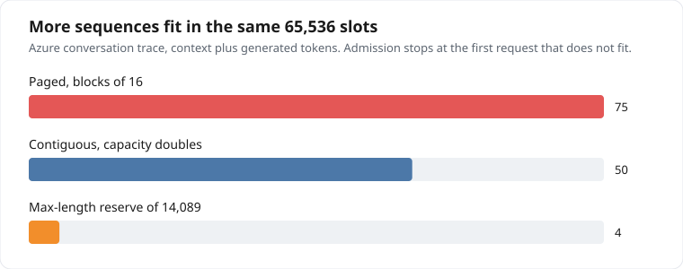
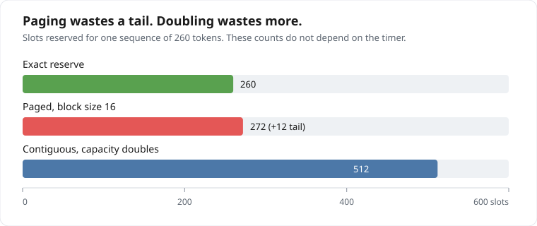
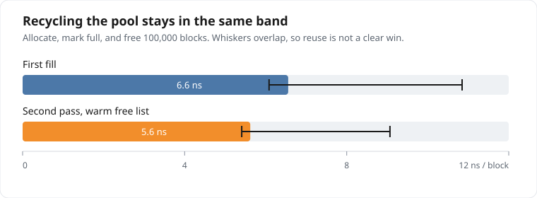

# paged-kv

This library keeps fixed-size blocks. A pool created with storage holds one `f32` vector in each token slot.

```sh
cargo run --example fake_attention
```

That prints five token ids, the block and slot each one landed in, attention scores, and a zero vector after the table is released. The scores are softmax weights over the stored keys. The context is those weights applied to the stored values. The vector written for a token id is a fixed embedding. Attention reads whatever is in the slots, so changing a stored key changes the scores. `encode` and `decode` turn text into byte ids and back. `generate` runs one fixed-weight block on that text and returns the ids it appended. The block is not trained, and it does not load anyone else's weights. A metadata pool does not run it.

```rust
use paged_kv::{BlockPool, BlockTable, attend, fill_tokens};

fn main() -> Result<(), paged_kv::AllocError> {
    let head_dim = 4;
    let tokens = [7u32, 3, 9, 1, 4];
    let mut pool = BlockPool::with_storage(4, 4, head_dim * 2);
    let mut table = BlockTable::new();

    fill_tokens(&mut pool, &mut table, head_dim, &tokens)?;
    let attention = attend(&pool, &table, head_dim)?;
    assert_eq!(attention.scores.len(), tokens.len());
    assert_eq!(attention.context.len(), head_dim as usize);

    table.release(&mut pool)?;
    Ok(())
}
```

`with_storage(4, 4, 8)` is 4 blocks, 4 token slots each, 8 floats per slot. The first half of a slot is K and the second half is V. `fill_tokens` grows the table and writes those halves. `release` gives the blocks back and zeroes the vectors. Dropping a table without `release` leaves the blocks marked in use until the pool is dropped.

## Install the Python package

From a clean virtualenv, in this repo:

```sh
python3 -m venv .venv
.venv/bin/pip install ./paged-kv-py
.venv/bin/python -c 'import paged_kv; print(paged_kv.encode("hi")); print(paged_kv.generate("hi", 2))'
```

That prints the byte ids of `"hi"`, then the same ids plus the two the block appended, and the decoded text. `cargo run --example scheduled_attention` prints that same continuation, one step at a time. `decode` turns ids back into text and skips the end-of-sequence id.

```python
import paged_kv

assert paged_kv.encode("hi") == [104, 105]
ids, text = paged_kv.generate("hi", 2)
assert ids == [104, 105, 34, 7]
assert text == paged_kv.decode(ids)
```

The block is not trained, so those two ids are just its argmax. Failures raise `ValueError`.

The same package can also fill slots and score them:

```python
import paged_kv

pool = paged_kv.BlockPool.with_storage(4, 2, 4)
table = paged_kv.BlockTable()
paged_kv.fill_tokens(pool, table, 2, [1, 2, 3])
scores, context = paged_kv.attend(pool, table, 2)
assert len(scores) == 3 and abs(sum(scores) - 1.0) < 1e-5
assert len(context) == 2
block, slot = table.token_loc(pool, 2)
pool.set_kv(block, slot, [9.0, 9.0, 9.0, 9.0])
table.release(pool)
```

`pip install` builds the extension. These calls are covered by `a_python_caller_reserves_shares_and_preempts`.

## Write your own vector

```rust
use paged_kv::{BlockPool, BlockTable};

fn main() -> Result<(), paged_kv::AllocError> {
    let mut pool = BlockPool::with_storage(8, 16, 4);
    let mut table = BlockTable::new();
    table.grow(&mut pool, 20)?;

    let loc = table.token_loc(&pool, 19)?;
    pool.kv_mut(loc.block, loc.slot)?.copy_from_slice(&[1.0, 2.0, 3.0, 4.0]);

    table.release(&mut pool)?;
    Ok(())
}
```

`token_loc` is the handle a forward pass writes through. A block another sequence still shares cannot be written in place. `cow` copies the filled slots into a private block first. `BlockPool::new` is the metadata-only pool used by the benches below. It has no vectors, and `kv_mut` returns an error.

## Batch a few sequences

The scheduler queues requests and reserves blocks. If the pool stores vectors, admission writes the prompt and each step writes one new token, then attention runs over that sequence. `cargo run --example scheduled_attention` encodes the string `"hi"`, runs that block, and prints the tokens as text. The next id is the block's argmax, and the new slot stores the block's K and V. A metadata pool does not run the block. The cost charts measure bookkeeping time on that pool. Paging still matters when many sequences share one pool. One sequence whose length you already know is a simpler problem, and [`ContiguousTable`](#one-contiguous-length) is faster at bookkeeping. The cost charts below are that comparison. The packing chart is how many sequences fit in one budget.

```rust
use paged_kv::{BlockPool, Scheduler};

fn main() -> Result<(), paged_kv::AllocError> {
    let mut sched = Scheduler::new(BlockPool::new(32, 16), 1);
    let first = sched.add(32, 1);
    let second = sched.add(16, 1);

    assert_eq!(sched.admit()?, vec![first]);
    assert_eq!(sched.next_waiting().map(|seq| seq.id()), Some(second));

    let step = sched.step()?;
    assert_eq!(step.finished, vec![first]);
    assert_eq!(sched.retire()?, vec![first]);

    assert_eq!(sched.admit()?, vec![second]);
    assert_eq!(sched.step()?.finished, vec![second]);
    assert_eq!(sched.retire()?, vec![second]);
    assert!(sched.is_idle());
    Ok(())
}
```

`add` only queues the request. `admit` reserves the whole prompt for the oldest waiting sequence, while the batch has room and the prompt fits. A prompt that does not fit stays at the head of the queue, and smaller requests behind it wait. `step` appends one token to every decoding sequence, or to none of them if the pool cannot cover the whole batch. A finished sequence keeps its batch slot until `retire`. A request with `max_new_tokens == 0` finishes as soon as its prompt is reserved.

When the batch is full, or the next prompt needs memory the batch is holding, you can preempt the newest decoding sequence. The oldest one stays. Admission does not preempt on its own. The preempted sequence goes to the back of the queue, so the request that was stuck at the front can run.

```rust
use paged_kv::{BlockPool, PreemptPolicy, Scheduler};

fn main() -> Result<(), Box<dyn std::error::Error>> {
    let mut sched = Scheduler::new(BlockPool::new(32, 16), 2);
    sched.add(16, 4);
    sched.add(16, 4);
    sched.admit()?;
    // Newest decoding sequence. Pause keeps its blocks.
    sched.preempt(PreemptPolicy::Pause)?;
    // The older one is still decoding. Recompute frees its blocks.
    sched.preempt(PreemptPolicy::Recompute)?;
    Ok(())
}
```

`Pause` keeps that sequence's blocks and the tokens it already generated. The next time it is admitted, decode continues. This frees a batch slot and does not free pool memory. `Recompute` returns the blocks to the pool and forgets the generated tokens. The sequence is prefilled again later. This is the policy that makes room for another prompt.

## Share a prompt prefix

The cache never reads token ids. You hash the prompt, or a prefix of it, and use that `u64` as the key.

```rust
use paged_kv::{BlockPool, BlockTable, PrefixCache};

fn main() -> Result<(), paged_kv::AllocError> {
    let mut pool = BlockPool::new(32, 16);
    let mut table = BlockTable::new();
    table.grow(&mut pool, 32)?;

    let prompt_hash = 0xabc;
    let mut cache = PrefixCache::new();
    cache.insert(&mut pool, prompt_hash, &table)?;

    let child = cache
        .lookup(&mut pool, prompt_hash, 32)?
        .expect("the prefix was cached");
    assert_eq!(cache.hit_rate(), 1.0);
    child.release(&mut pool)?;

    cache.clear(&mut pool)?;
    table.release(&mut pool)?;
    Ok(())
}
```

A lookup that forks a cached prefix is a hit. A missing key, or a cached table shorter than the prefix you asked for, is a miss. `hit_rate` is hits divided by hits plus misses, and it is `0.0` before the first lookup. `clear` returns the cached blocks. The scheduler does not consult this cache. Sharing is a step you take yourself.

## One contiguous length

```rust
use paged_kv::ContiguousTable;

fn main() -> Result<(), paged_kv::AllocError> {
    let mut span = ContiguousTable::new();
    span.reserve_exact(260);
    span.grow(260)?;
    assert_eq!(span.capacity(), 260);
    Ok(())
}
```

There is no pool, no free list, and no sharing. `reserve_exact` sets the capacity to that length. `grow` without a reserve doubles capacity until the length fits, the way a normal buffer grows. `grow` does not shrink the span.

## Run the checks

The Python module has the same scheduler. `preempt("pause")` keeps blocks. `preempt("recompute")` frees them.

```sh
cargo test
cargo test -p paged-kv-py
cargo bench --bench packing
cargo bench --bench paged_vs_contiguous
cargo bench --bench alloc_load
cargo bench --bench scheduler_overhead
```

## How many sequences fit

Paging is for a fixed pool and uneven lengths. The budget here is 65,536 token slots. Fifteen of every sixteen sequences are 40 tokens. Every sixteenth is 1,000. Each allocator admits sequences in that order and stops at the first one that does not fit. It does not skip a long sequence to take a shorter one behind it.



Paged blocks fit 543 more sequences than reserving 1,024 slots for every sequence, and 78 more than a buffer that doubles. Wasted slots are reserved room with no live token. Slots that were never reserved are not counted. A max-length reserve pays 1,024 slots even for a 40-token sequence. Doubling rounds each length up to a power of two, 64 or 1,024. Paging rounds up to 16, so those lengths reserve 48 and 1,008.

| Allocator | Sequences that fit | Slots wasted |
| --- | --- | --- |
| Paged, blocks of 16 | 607 | 4,856 |
| Contiguous, capacity doubles | 529 | 12,696 |
| Max-length reserve of 1,024 | 64 | 59,136 |

These counts do not depend on a timer. `cargo bench --bench packing` prints them. `skewed_lengths_fit_more_sequences_in_a_paged_pool` locks them.

## What the bookkeeping costs

The counts above are the benefit: how many sequences fit. The timings here are the cost of the bookkeeping, not that benefit.

These benches call `BlockPool::new`, so they store no vectors and copy no KV bytes. The numbers are the cost of updating lengths, free lists, and block ids. Each chart is one release run on an Intel i9-9900, rustc 1.99.1: 3 warmup runs, then the median of 21.


512 sequences grow to 260 tokens, one token at a time, and stay live together. Paged blocks take 5.42 ms. A contiguous length that doubles takes 0.25 ms. That is about 22×. The slowest doubling run, 0.41 ms, is still under the fastest paged run, 5.19 ms. Dividing the paged median by 512 × 260 steps is about 40 ns of bookkeeping per step.

Each paged step may pop the free list, update a used-slot count, and copy the block-id list so a failed `grow` can roll back. A new block is handed out every 16 tokens. The contiguous side adds one to a length.



Doubling is the fast bar, and it is also the roomiest. For one sequence of 260 tokens, an exact reserve holds 260 slots, pages of 16 hold 272 (a 12-slot tail), and doubling lands on 512. Paging reserves less spare room than geometric growth. Knowing the length in advance reserves less than paging.

Asking for all 260 tokens in one call, instead of stepping, brings the paged median to 0.83 ms (min 0.81, max 1.08). The contiguous exact path writes one capacity: median 2.8 µs. One sample spiked to 20 µs, and that spike is still below every paged sample. About 290× at the medians. This is one reservation, not the decode loop.

| Policy | min | median | max |
| --- | --- | --- | --- |
| Contiguous, double each token | 0.249 ms | 0.250 ms | 0.413 ms |
| Paged, one token at a time | 5.188 ms | 5.423 ms | 6.434 ms |
| Contiguous, exact reserve | 2.7 µs | 2.8 µs | 19.8 µs |
| Paged, one `grow` to 260 | 0.810 ms | 0.829 ms | 1.080 ms |

`cargo bench --bench paged_vs_contiguous` prints the nanoseconds behind this table.



`cargo bench --bench alloc_load` allocates 100,000 blocks, marks each one full, and frees them. Pool construction is outside the timer. The first pass is 6.6 ns per block at the median (6.1 to 10.8). The second pass, on a warm free list, is 5.6 ns (5.4 to 9.1). The ranges overlap, so recycling is in the same band as the first fill.


`cargo bench --bench scheduler_overhead` runs 256 sequences of 128 prompt tokens and 64 generated tokens, block size 16, batch of 16, pool of 192 blocks. Both paths use the paged pool. The one-sequence loop finishes a sequence before starting the next. The scheduler keeps 16 live.

| Path | min | median | max |
| --- | --- | --- | --- |
| One sequence at a time | 0.824 ms | 0.836 ms | 1.021 ms |
| Scheduler, batch of 16 | 1.148 ms | 1.207 ms | 1.554 ms |

The scheduler median is 1.44× the one-sequence loop, and every scheduler run is slower than the slowest one-sequence run. Two earlier runs on this machine were 1.38× and 1.38×. On bookkeeping alone, the queue costs more than it saves. There is no model step underneath for that cost to hide behind.

## What these numbers leave out

- The benches use the metadata pool. Filling the `f32` vectors, and the attention step, are not in these timings.
- Every sequence in the paged-versus-contiguous bench stays live at once. A pool that is filled, freed, and filled again over a long run is a different story. The allocate/free bench is the one that recycles, and it shows no clear saving.
- Nothing in the benches shares a prefix. `PrefixCache` can avoid a second set of blocks. That saving is not in the timings.
- The scheduler adds its own cost on top of paging. Head-of-line blocking and all-or-nothing steps are part of that design.

## What this is not

- A trained model, or a loader for someone else's checkpoint. `encode` and `decode` are a byte vocabulary, not a BPE model. On a storage pool the scheduler writes K and V from one fixed block and takes the next id from that block. `fill_tokens` still writes a fixed embedding for a caller who does not use the scheduler. `attend` reads whatever is stored.
- A GPU tensor, or fp16. Storage is one `f32` vector per token slot on the CPU.
- A serving server, and not a client for one.
- A multi-device cache.
- Automatic prefix sharing. The cache is there. `Scheduler::admit` does not call it.
- Automatic preemption. `preempt` runs when you call it.
- Chunked prefill. Admission reserves the whole prompt.
- A skip of a prompt that does not fit. The requests behind it wait.

## How the pool is laid out

`BlockPool::new(num_blocks, block_size)` builds three parallel structures, indexed by `BlockId`:

| State | Meaning |
| --- | --- |
| `refcounts[id]` | Live owners. `0` means the block is free. |
| `used[id]` | Initialized token slots in that block, at most `block_size`. |
| `free_list` | Stack of free ids. `allocate` pops it. `free` pushes an id when its refcount hits zero. |

A fresh pool is stacked from high ids down to zero, so the first allocations are `0, 1, 2, ...`. After that, the most recently freed id is handed out next.

Blocks are interchangeable. A hole on the free list can be used by any request, so the pool has no external fragmentation. The waste it reports is internal: `block_size - used` on each live block, counted once even when several owners share it. An idle pool reports zero. A freshly allocated block starts at `used == 0`, so it counts as fully wasted until the caller fills it.

`allocate` returns one block with refcount 1. `acquire` adds an owner. `free` drops one owner and recycles the block at zero. A second free of an already free block is rejected. `cow` returns the same id when the refcount is 1. When the block is shared, it allocates a new block, copies the initialized length, copies any stored vectors for those slots, and drops one reference to the original. If that allocation fails, the shared block is unchanged. Freeing the last owner zeroes a stored block.

`BlockTable` holds one reference per block it lists. Full blocks are marked fully used. The tail holds the remainder. `grow` does not shorten a table. If the pool cannot cover the whole request, the table and the pool stay as they were.

`fork_prefix(prefix_len)` builds another table for the first `prefix_len` tokens:

- A prefix that ends on a block boundary shares those full blocks.
- A prefix that covers the whole table also shares a partial tail. The next append into that tail copy-on-writes it.
- A prefix that stops inside a block the parent has already written past shares the full blocks before that point and gets a new private block for the partial length.
- A failure rolls the acquires back. A zero-length prefix allocates nothing. A prefix past the table length changes no refcount.

```rust
use paged_kv::{BlockPool, BlockTable};

fn share_a_prefix() -> Result<(), paged_kv::AllocError> {
    let mut pool = BlockPool::new(8, 16);
    let mut parent = BlockTable::new();
    parent.grow(&mut pool, 20)?;

    let mut child = parent.fork_prefix(&mut pool, 20)?;
    child.grow(&mut pool, 21)?;

    child.release(&mut pool)?;
    parent.release(&mut pool)?;
    Ok(())
}
```

## Where a claim is checked

| Claim | Test or bench |
| --- | --- |
| Allocate, free, and reuse the last freed id | `allocate_and_free_round_trip`, `most_recently_freed_block_is_reused_first` |
| Tail waste, counted once when a block is shared | `partial_block_reports_tail_waste`, `shared_owners_do_not_double_count_tail_waste` |
| Copy-on-write of a shared block | `cow_keeps_a_unique_block_in_place`, `cow_forks_a_shared_block_without_changing_the_other_owner` |
| Prefix fork, including rollback | `fork_on_a_block_boundary_shares_only_the_covered_blocks`, `fork_of_the_whole_sequence_shares_the_tail_until_append`, `fork_inside_a_written_block_gets_a_private_boundary`, `fork_rolls_back_acquires_when_the_private_block_cannot_be_allocated` |
| `grow` refuses to shrink, and a failed grow changes nothing | `grow_rejects_a_shorter_length_and_an_allocation_it_cannot_finish` |
| Prompt and generated tokens share one table | `prompt_and_generated_tokens_share_one_table` |
| `max_new_tokens == 0` finishes at reservation | `zero_new_tokens_finishes_when_the_prompt_is_reserved` |
| Doubling and exact reserve | `grow_doubles_capacity_until_the_length_fits`, `reserve_exact_does_not_double_past_the_request` |
| Arrival order, and a full batch | `admission_follows_arrival_order_and_stops_at_the_batch_size` |
| A prompt that does not fit blocks the queue | `a_prompt_that_does_not_fit_blocks_smaller_requests_behind_it` |
| A finished sequence keeps its slot | `a_finished_sequence_keeps_its_slot_until_retire` |
| `step` is all or nothing | `step_is_all_or_nothing_when_the_batch_cannot_grow` |
| A fake generation loop frees every block | `fake_generation_joins_sequences_and_frees_every_block` |
| Pause keeps generated tokens | `pause_frees_a_batch_slot_and_keeps_generated_tokens` |
| Recompute frees blocks for the waiting prompt | `recompute_frees_blocks_so_a_waiting_prompt_can_fit` |
| The oldest running sequence stays | `the_oldest_running_sequence_stays_when_a_newer_one_is_preempted` |
| Prefix hit, miss, and rate | `a_miss_then_a_hit_shares_blocks_and_records_the_rate`, `a_cached_table_that_is_too_short_counts_as_a_miss` |
| Stored vectors, zeroed on free, copied by `cow` | `stored_kv_is_writable_until_the_block_is_freed`, `cow_copies_stored_kv_and_leaves_the_other_owner_unchanged` |
| A token index maps to a block and slot | `token_loc_maps_a_logical_index_onto_a_block_slot` |
| `attend` reads stored K and V, and release zeroes the block | `fill_then_attend_reads_the_stored_keys_and_free_zeroes_them` |
| A scheduled generation writes the block's K and V and appends the id that block chose | `a_generation_loop_writes_nonzero_kv` |
| The fixed block's weights stay put, and its scores read the stored rows | `weights_do_not_drift`, `forward_reads_the_stored_rows` |
| `encode` then `decode` returns the same string | `encode_then_decode_round_trips` |
| `generate` appends the ids the fixed block chose | `generate_appends_ids_from_the_block` |
| Python `encode`, `decode`, `generate`, and `fill_tokens` | `a_python_caller_reserves_shares_and_preempts` |
| A fixed budget fits more skewed sequences when blocks are paged | `skewed_lengths_fit_more_sequences_in_a_paged_pool`, `cargo bench --bench packing` |
| Paged versus contiguous, including slot counts | `cargo bench --bench paged_vs_contiguous` |
| Allocate and free under load | `cargo bench --bench alloc_load` |
| Scheduler versus one sequence | `cargo bench --bench scheduler_overhead` |
