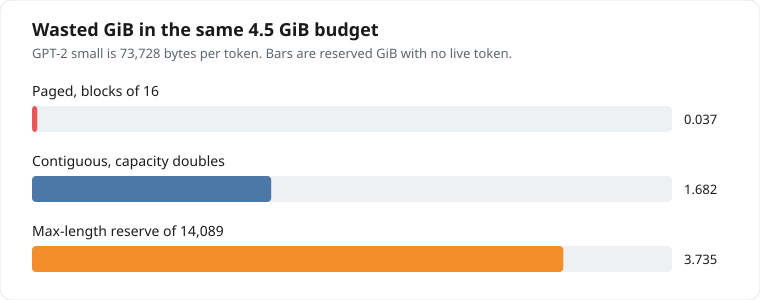
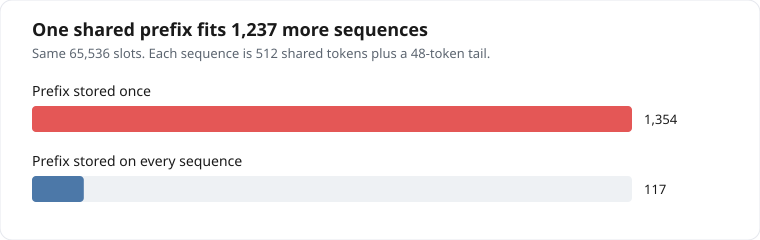
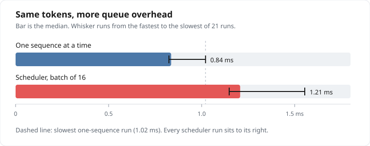

# paged-kv

Paged KV-cache blocks and an FCFS scheduler.

On the Azure conversation trace, paged blocks fit 75 sequences in 65,536 slots (4.5 GiB). A doubling buffer fits 50. Reserving the longest request for every sequence fits 4.

| Allocator | Sequences that fit | Slots wasted | Bytes wasted | GiB wasted |
| --- | --- | --- | --- | --- |
| Paged, blocks of 16 | 75 | 541 | 39,886,848 | 0.037 |
| Contiguous, capacity doubles | 50 | 24,496 | 1,806,041,088 | 1.682 |
| Max-length reserve of 14,089 | 4 | 54,392 | 4,010,213,376 | 3.735 |

## Try it

Add the crate:

```sh
cargo add paged-kv
```

Run the GPT-2 example with the `gpt2` feature. The first run downloads `openai-community/gpt2`.

```sh
cargo run --example scheduled_attention --features gpt2 -- "The capital of France is"
```

`cargo run --example fake_attention` writes a fixed embedding and prints the scores. It does not download a model.

## What this is not

- The only checkpoint is `openai-community/gpt2`, stored as CPU `f32`. There is no GPU, fp16 or second model.
- There is no serving server and no continuous batching. The example runs one sequence.
- Prefix sharing and preemption happen only when you call them. A prompt that does not fit blocks the requests behind it.
- `encode` and `decode` are a byte vocabulary. `generate` uses GPT-2's tokenizer.

## A short call

`BlockPool::new` tracks block ids only. `with_storage` also stores one `f32` vector per token slot. Call `release` when you are done. Dropping a table without `release` leaves the blocks marked in use until the pool is dropped.

```rust
use paged_kv::{BlockPool, BlockTable, attend, fill_tokens};

fn main() -> Result<(), paged_kv::AllocError> {
    let head_dim = 4;
    let tokens = [7u32, 3, 9, 1, 4];
    let mut pool = BlockPool::with_storage(4, 4, head_dim * 2);
    let mut table = BlockTable::new();

    fill_tokens(&mut pool, &mut table, head_dim, &tokens)?;
    let attention = attend(&pool, &table, head_dim)?;
    assert_eq!(attention.scores.len(), tokens.len());
    assert_eq!(attention.context.len(), head_dim as usize);

    table.release(&mut pool)?;
    Ok(())
}
```

From a virtualenv in this repo:

```sh
python3 -m venv .venv
.venv/bin/pip install ./paged-kv-py
.venv/bin/python -c 'import paged_kv; print(paged_kv.encode("hi"))'
```

`encode("hi")` returns `[104, 105]`. `generate` needs the `gpt2` feature.

## Where the table comes from




Lengths are context tokens plus generated tokens from the Azure conversation trace released with Splitwise (Patel et al., ISCA 2024): 19,366 requests from 2023-11-16 18:15:46 through 19:14:08, admitted in that order. The list is `benches/support/azure_conv_totals.txt` (CC-BY, Azure Public Dataset). Admission stops at the first request that does not fit.

One GPT-2 small token is 12 layers of K and V, 768 `f32` values each. That is 73,728 bytes, so 65,536 slots are 4.5 GiB. GiB waste is rounded to three decimals. The packing bench stores no vectors. `cargo bench --bench packing` prints the counts.

The older synthetic mix was fifteen lengths of 40 and one of 1,000, repeating, with a reserve of 1,024. It fit 607 paged, 529 doubling and 64 max-length, wasting 4,856, 12,696 and 59,136 slots.

<details>
<summary>Prefix sharing fits 1,354 sequences instead of 117. Bookkeeping timings.</summary>

Same budget, 65,536 slots, blocks of 16. Each sequence is a 512-token prefix and a 48-token tail.



| | Sequences that fit |
| --- | --- |
| Prefix stored on every sequence | 117 |
| Prefix stored once | 1,354 |

That is 1,237 more. `cargo bench --bench prefix_sharing` prints both counts.

The timings below are bookkeeping on the metadata pool, not the packing result. Each chart is one release run on an x86-64 desktop CPU, rustc 1.99.1: 3 warmup runs, then the median of 21.


512 sequences grow to 260 tokens, one token at a time, and stay live together. Paged blocks take 5.42 ms. A contiguous length that doubles takes 0.25 ms. That is about 22×.


For one sequence of 260 tokens, an exact reserve holds 260 slots, pages of 16 hold 272, and doubling holds 512.

| Policy | min | median | max |
| --- | --- | --- | --- |
| Contiguous, double each token | 0.249 ms | 0.250 ms | 0.413 ms |
| Paged, one token at a time | 5.188 ms | 5.423 ms | 6.434 ms |
| Contiguous, exact reserve | 2.7 µs | 2.8 µs | 19.8 µs |
| Paged, one `grow` to 260 | 0.810 ms | 0.829 ms | 1.080 ms |

`cargo bench --bench paged_vs_contiguous` prints the nanoseconds behind this table.


`cargo bench --bench alloc_load` allocates 100,000 blocks, marks each one full, and frees them. The first pass is 6.6 ns per block at the median (6.1 to 10.8). The second pass is 5.6 ns (5.4 to 9.1). The ranges overlap.



`cargo bench --bench scheduler_overhead` runs 256 sequences of 128 prompt tokens and 64 generated tokens, block size 16, batch of 16, pool of 192 blocks. Both paths use the paged pool.

| Path | min | median | max |
| --- | --- | --- | --- |
| One sequence at a time | 0.824 ms | 0.836 ms | 1.021 ms |
| Scheduler, batch of 16 | 1.148 ms | 1.207 ms | 1.554 ms |

The scheduler median is 1.44× the one-sequence loop. Every scheduler run is slower than the slowest one-sequence run.

These benches do not fill `f32` vectors or run attention. The timing runs do not share a prefix.

</details>

<details>
<summary>Where a claim is checked</summary>

| Claim | Test or bench |
| --- | --- |
| Allocate, free, and reuse the last freed id | `allocate_and_free_round_trip`, `most_recently_freed_block_is_reused_first` |
| A seeded mix of allocate, free, share, and release keeps free plus live equal to capacity | `allocator_refcounts_stay_non_negative_under_a_seeded_mix` |
| Tail waste, counted once when a block is shared | `partial_block_reports_tail_waste`, `shared_owners_do_not_double_count_tail_waste` |
| Copy-on-write of a shared block | `cow_keeps_a_unique_block_in_place`, `cow_forks_a_shared_block_without_changing_the_other_owner` |
| Prefix fork, including rollback | `fork_on_a_block_boundary_shares_only_the_covered_blocks`, `fork_of_the_whole_sequence_shares_the_tail_until_append`, `fork_inside_a_written_block_gets_a_private_boundary`, `fork_rolls_back_acquires_when_the_private_block_cannot_be_allocated` |
| `grow` refuses to shrink, and a failed grow changes nothing | `grow_rejects_a_shorter_length_and_an_allocation_it_cannot_finish` |
| Prompt and generated tokens share one table | `prompt_and_generated_tokens_share_one_table` |
| `max_new_tokens == 0` finishes at reservation | `zero_new_tokens_finishes_when_the_prompt_is_reserved` |
| Doubling and exact reserve | `grow_doubles_capacity_until_the_length_fits`, `reserve_exact_does_not_double_past_the_request` |
| Arrival order, and a full batch | `admission_follows_arrival_order_and_stops_at_the_batch_size` |
| A prompt that does not fit blocks the queue | `a_prompt_that_does_not_fit_blocks_smaller_requests_behind_it` |
| A finished sequence keeps its slot | `a_finished_sequence_keeps_its_slot_until_retire` |
| `step` is all or nothing | `step_is_all_or_nothing_when_the_batch_cannot_grow` |
| A fake generation loop frees every block | `fake_generation_joins_sequences_and_frees_every_block` |
| Pause keeps generated tokens | `pause_frees_a_batch_slot_and_keeps_generated_tokens` |
| Recompute frees blocks for the waiting prompt | `recompute_frees_blocks_so_a_waiting_prompt_can_fit` |
| The oldest running sequence stays | `the_oldest_running_sequence_stays_when_a_newer_one_is_preempted` |
| Prefix hit, miss, and rate | `a_miss_then_a_hit_shares_blocks_and_records_the_rate`, `a_cached_table_that_is_too_short_counts_as_a_miss` |
| Stored vectors, zeroed on free, copied by `cow` | `stored_kv_is_writable_until_the_block_is_freed`, `cow_copies_stored_kv_and_leaves_the_other_owner_unchanged` |
| A token index maps to a block and slot | `token_loc_maps_a_logical_index_onto_a_block_slot` |
| `attend` reads stored K and V, and release zeroes the block | `fill_then_attend_reads_the_stored_keys_and_free_zeroes_them` |
| A scheduled generation writes GPT-2's K and V and appends the id from its logits | `a_generation_loop_writes_the_model_kv`, `gpt2_next_token_comes_from_the_logits` |
| `encode` then `decode` returns the same string | `encode_then_decode_round_trips` |
| `generate` appends the id GPT-2's logits chose | `generate_appends_ids_from_the_model` |
| Python `encode`, `decode`, `generate`, and `fill_tokens` | `a_python_caller_reserves_shares_and_preempts` |
| A fixed budget fits more conversation-trace sequences when blocks are paged | `conversation_trace_fits_more_sequences_in_a_paged_pool`, `cargo bench --bench packing` |
| One shared prefix fits more sequences in that same budget | `a_shared_prefix_fits_more_sequences`, `cargo bench --bench prefix_sharing` |
| Paged versus contiguous, including slot counts | `cargo bench --bench paged_vs_contiguous` |
| Allocate and free under load | `cargo bench --bench alloc_load` |
| Scheduler versus one sequence | `cargo bench --bench scheduler_overhead` |

</details>
