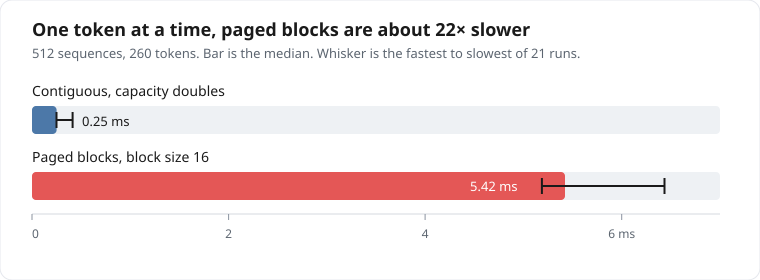

# paged-kv

A Rust block pool for a paged KV cache, and a first-come, first-served continuous batcher.

The pool does not store tensors. The caller owns the KV bytes and addresses them with a `BlockId`. The scheduler does not run a model. It queues sequences, reserves prompt blocks, appends one fake decode token at a time, and retires finished sequences.

## Paged metadata is slower than a contiguous span

No KV bytes are copied. The charts compare bookkeeping only, on Linux WSL2, an i9-9900, rustc 1.99.1. Each timed figure is the median of 21 release runs after 3 warmup runs.



512 sequences grow to 260 tokens, one token at a time, and stay live together. The paged median is 5.42 ms. The contiguous doubling median is 0.25 ms. That is about 22×. The slowest doubling run (0.41 ms) is still well under the fastest paged run (5.19 ms).


The time win for doubling is not a memory win. A doubling buffer for 260 tokens lands on 512 slots. Paged blocks of 16 land on 272, twelve of them unused. An exact reserve stays at 260. So paging is tighter than geometric growth and looser than knowing the length up front.

Reserving the whole 260 in one call, instead of stepping, drops the paged median to 0.83 ms (min 0.81, max 1.08). The contiguous exact path is a capacity write: median 2.8 µs. One sample spiked to 20 µs, and that spike is still below every paged sample. About 290× at the medians. This is not the decode loop. It is the cost of walking the block pool once per sequence.

| Policy | min | median | max |
| --- | --- | --- | --- |
| Contiguous, double each token | 0.249 ms | 0.250 ms | 0.413 ms |
| Paged, one token at a time | 5.188 ms | 5.423 ms | 6.434 ms |
| Contiguous, exact reserve | 2.7 µs | 2.8 µs | 19.8 µs |
| Paged, one `grow` to 260 | 0.810 ms | 0.829 ms | 1.080 ms |

`cargo bench --bench paged_vs_contiguous` prints the nanoseconds behind this table.

## Recycling blocks stays in the same band


`cargo bench --bench alloc_load` fills 100,000 blocks, marks each one full, and frees them. Pool construction is outside the timer. The first pass is 6.6 ns per block at the median (6.1 to 10.8). The second pass, on a warm free list, is 5.6 ns (5.4 to 9.1). The ranges overlap, so recycling is not a clear saving and not a penalty either.

## Scheduler queue versus one sequence

`cargo bench --bench scheduler_overhead` times the scheduler against a loop that runs the same prompts and decode tokens one sequence at a time. Both paths use the paged pool. This is not model throughput.


256 sequences, 128 prompt tokens, 64 generated tokens, block size 16, batch of 16, pool of 192 blocks. Release build on Linux WSL2 x86_64, rustc 1.99.1. Three warmup iterations, then 21 timed runs.

The scheduler median is 1.44× the one-sequence loop. The queue keeps 16 sequences live. The other loop finishes one sequence before the next. On this metadata-only workload, that bookkeeping costs more than it saves. Two earlier runs on this host were 1.38× and 1.38×.

The chart is drawn from this run:

| Path | min | median | max |
| --- | --- | --- | --- |
| One sequence at a time | 0.824 ms | 0.836 ms | 1.021 ms |
| Scheduler, batch of 16 | 1.148 ms | 1.207 ms | 1.554 ms |

## What works

- `BlockPool` allocates fixed-size blocks, recycles them from a free list, counts owners, and copy-on-writes a shared block.
- `BlockTable` maps a token length onto blocks and can fork a prefix.
- `Sequence` splits that length into prompt tokens and generated tokens (`prompt_and_generated_tokens_share_one_table`).
- `ContiguousTable` is the non-paged baseline: one length and one capacity (`grow_doubles_capacity_until_the_length_fits`, `reserve_exact_does_not_double_past_the_request`).
- `Scheduler` admits in arrival order, steps the batch, and retires finished sequences (`step_then_retire_frees_blocks_and_admits_the_next_sequence`, `fake_generation_joins_sequences_and_frees_every_block`).

`cargo test` covers the behavior named below.

## What this is not

- No model, tokenizer, attention kernel, or KV tensor copy.
- No Python bindings.
- No preemption, and no priority other than arrival order.
- The scheduler does not share prefixes. `BlockTable::fork_prefix` can, and admission does not call it.
- No chunked prefill. Admission reserves the whole prompt at once.
- A prompt that does not fit is not skipped. Smaller requests behind it wait (`a_prompt_that_does_not_fit_blocks_smaller_requests_behind_it`).
- A finished sequence keeps its batch slot until `retire` (`a_finished_sequence_keeps_its_slot_until_retire`).
- `step` grows every decoding sequence or none of them (`step_is_all_or_nothing_when_the_batch_cannot_grow`).
- The paged-versus-contiguous bench does not move KV bytes, does not share prefixes, and does not run sequences one after another. A fixed pool that is reused over time is not what those timings show.
- No multi-device cache.

## Where paging costs more

- Stepping one token at a time touches the free list, the used-slot array, and release. A contiguous length does not. That is the 22× gap above.
- Even one `grow` to the full length still allocates every block. An exact reserve writes one integer.
- The tail of a partial block is empty slots. At block size 16 and length 260, that is 12 slots per sequence. Doubling can waste more than that. Exact reserve wastes none.
- Owners, copy-on-write, and `release` are extra rules. Dropping a table without `release` leaks references. A `ContiguousTable` does not borrow from a pool.
- The scheduler adds another cost on top of paging. Its median was 1.44× a one-sequence loop that already used the paged pool. Head-of-line blocking and all-or-nothing steps are part of that design, not of the contiguous baseline.
- Prefix sharing can avoid a second copy. Nothing in these benches shares a prefix, so that benefit is not a measured saving.

Dropping a `BlockTable` or a `Sequence` that holds blocks, without `release`, leaks those references until the pool is dropped. The table type is marked `must_use`. The tests release what they allocate.

## Scheduler

Admission is first-come, first-served. Arrival order is the admission order, which keeps the queue testable. There is no priority heap.

`add` enqueues a prompt length and a decode budget. It does not allocate. `admit` reserves blocks for the oldest waiting prompt while the batch has a free slot and the prompt fits (`admission_follows_arrival_order_and_stops_at_the_batch_size`). `step` appends one generated token to each decoding sequence. `retire` returns finished blocks to the pool. A request with `max_new_tokens == 0` finishes as soon as its prompt is reserved (`zero_new_tokens_finishes_when_the_prompt_is_reserved`).

## Memory layout

`BlockPool::new(num_blocks, block_size)` builds three parallel structures, indexed by `BlockId`:

| State | Meaning |
| --- | --- |
| `refcounts[id]` | Live owners. `0` means the block is free. |
| `used[id]` | Initialized token slots in that block. `0` when the block is free, and at most `block_size` when it is live. |
| `free_list` | Stack of free ids. `allocate` pops it. `free` pushes an id only when its refcount hits zero. |

A fresh pool is stacked from high ids down to zero, so the first allocations are `0, 1, 2, ...` (`most_recently_freed_block_is_reused_first`). After that, the most recently freed id is handed out next.

One block represents `block_size` token slots. Those bytes are not in this crate. A block id is valid only in the pool that issued it. Copying a `BlockId` does not change its refcount (`shared_block_stays_live_until_the_last_owner_frees_it`).

Blocks are interchangeable. A hole on the free list is reusable for any request, so the pool has no external fragmentation. The waste it reports is internal: `block_size - used` on each live block. `wasted_slots` sums that once per physical block, including when several owners share it (`shared_owners_do_not_double_count_tail_waste`). An idle pool reports zero (`idle_pool_has_zero_fragmentation`). A freshly allocated block starts at `used == 0`, so it counts as fully wasted until the caller fills it (`partial_block_reports_tail_waste`).

## Ownership

- `allocate` returns one block with refcount 1.
- `acquire` adds an owner of the current contents. It fails on a free or unknown id (`acquire_rejects_a_free_or_unknown_block`).
- `free` drops one owner. The initialized length stays until the last owner frees the block. The last free pushes the id and clears `used` (`freeing_a_partial_block_drops_its_waste`). A second free of an already free block is `NotAllocated` and does not push a duplicate (`double_free_is_rejected_and_does_not_grow_the_free_list`).
- `cow` returns the same id when the refcount is 1 (`cow_keeps_a_unique_block_in_place`). When the block is shared, it allocates a new block, copies the initialized length, and drops one reference to the original. The other owners still see the original length (`cow_forks_a_shared_block_without_changing_the_other_owner`). The caller copies KV bytes only when the returned id differs. If the pool cannot allocate the fork, the shared block is unchanged (`cow_of_a_shared_block_fails_cleanly_when_the_pool_is_full`).
- `BlockTable` holds one reference per block it lists. It does not own the pool. `release` drops those references. Other tables that still hold a block keep it allocated (`fork_on_a_block_boundary_shares_only_the_covered_blocks`).

## How a prefix fork shares blocks

`BlockTable::grow` appends tokens. Full blocks are marked fully used. The tail holds the remainder (`grow_fills_full_blocks_and_a_partial_tail`). `grow` does not shorten a table (`grow_rejects_a_shorter_length_and_an_allocation_it_cannot_finish`). If the pool cannot cover the whole request, the table and the pool stay as they were.

`fork_prefix(prefix_len)` builds another table for the first `prefix_len` tokens:

- A prefix that ends on a block boundary shares those full blocks and leaves the parent's later blocks private.
- A prefix that covers the whole table also shares a partial tail. The next append into that tail copy-on-writes it (`fork_of_the_whole_sequence_shares_the_tail_until_append`). If that copy cannot be allocated, neither table changes (`extending_a_shared_tail_fails_cleanly_when_cow_cannot_allocate`).
- A prefix that stops inside a block the parent has already written past shares only the full blocks before that point. The child gets a new private block with `used` set to the partial length, so it does not alias the parent's later tokens (`fork_inside_a_written_block_gets_a_private_boundary`). If that private block cannot be allocated, the acquires are rolled back (`fork_rolls_back_acquires_when_the_private_block_cannot_be_allocated`).
- A zero-length prefix allocates nothing. A prefix past the table length returns `PrefixOutOfRange` and changes no refcount (`empty_and_overlong_prefixes_do_not_change_refcounts`).

Full blocks are not written in place. Extending past a full block allocates a new block, including after a boundary fork.

```rust
use paged_kv::{BlockPool, BlockTable};

fn share_a_prefix() -> Result<(), paged_kv::AllocError> {
    let mut pool = BlockPool::new(8, 16);
    let mut parent = BlockTable::new();
    parent.grow(&mut pool, 20)?;

    // Same contents, including the partial tail: both tables hold those ids.
    let mut child = parent.fork_prefix(&mut pool, 20)?;
    // The next token copy-on-writes the shared tail. The parent keeps the old id.
    child.grow(&mut pool, 21)?;

    child.release(&mut pool)?;
    parent.release(&mut pool)?;
    Ok(())
}
```

## What a Python caller would do

PyO3 bindings are not implemented. Nothing here imports. The call order a binding would expose is the same as the Rust API:

```python
pool = BlockPool(num_blocks=128, block_size=16)
table = BlockTable()
table.grow(pool, prompt_len)
while table.len < prompt_len + max_new_tokens:
    table.grow(pool, table.len + 1)
table.release(pool)
```

`ContiguousTable` would skip the pool and call `reserve_exact` or `grow` on the table alone.

## Tests and benchmarks

```sh
cargo test
cargo bench --bench paged_vs_contiguous
cargo bench --bench alloc_load
cargo bench --bench scheduler_overhead
```

Each bench prints nanoseconds. The charts and tables above are one release run on this WSL host.
